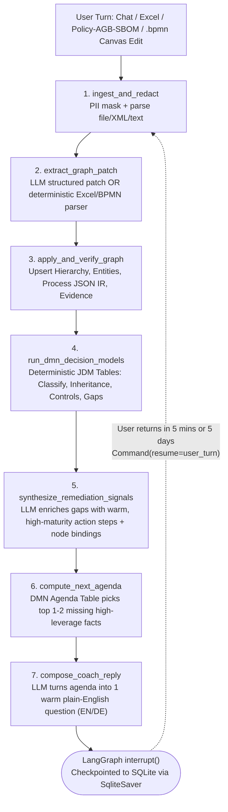

# PMGA v2 — Concrete Architecture & Implementation Plan

## Goal Description

Transform PMGA from a collection of disconnected prototypes (legacy 16-column survey, unused 133-question SQLite table, single-diagram overwrite bug, 7-regex handbook stub, and cluttered 3-tab UI) into one unified, multi-session, autonomously guided workbench for pre-digitalization process discovery and BSI IT-Grundschutz / ISO 27002 remediation.

After **2–3 guided sessions** (starting from *any* of 4 entry points: a messy Excel sheet like `Anmeldesystem | kritisch`, zero documents, uploaded policies/AGBs/SBOMs, or an existing `.bpmn` diagram), the user walks away with all four synchronized deliverables derived from **one single source of truth**:

1. **Gap-Annotated FIM-BPMN 2.0 Diagrams** (one per business process in the hierarchy, modeling actors/lanes, data objects/stores, systems, and clickable gap badges directly on affected nodes).
2. **Warm, Actionable BSI + ISO Gap & Remediation Plan** (never a scary "audit report" — supportive, plain-English operational, technical, and contractual next steps tied to exact BSI 200-2/200-4 and ISO 27002 clauses).
3. **Ready-to-Use Municipal Working Documents:**
   - **Prozesssteckbrief** (FIM-aligned process profile: trigger, actors, inputs/outputs, systems, legal/policy basis, CIA/BIA).
   - **BSI 200-2 Strukturanalyse & Schutzbedarfsfeststellung** (hierarchy + system/data links + automated *Maximumprinzip* inheritance).
   - **Target Remediation Roadmap** (prioritized quick wins vs. structural fixes, grouped by role).
4. **Brandable Document Export Pipeline** (Jinja2 HTML + fixed print-ready CSS layout with user-customizable logo, colors, and typography; native PDF via WeasyPrint in Linux/Docker + instant browser Print-to-PDF preview locally on Windows).

---

## Research Findings & Objective Reality Check

Before designing this plan, we verified existing tools, open-source work, and runtime constraints rather than assuming gaps blindly:

1. **DACH Market Reality (Why positioning matters):**
   - Tools like **verinice**, **HiScout** (now supporting **IT-Grundschutz++** machine-readable rules), **Symbio**, and **GBTEC (BIC BSI Grundschutz)** *do* support Excel asset imports and BPMN-to-Strukturanalyse links, while **Secjur** and **DataGuard** offer AI policy-to-control gap mapping.
   - **Where the real unaddressed gap sits:** All of those assume either clean structured inputs or trained GRC consultants. None provides a warm, turn-by-turn conversational onramp that starts from a semantically confused Excel row (`Anmeldesystem | kritisch` with no processes, actors, or data assets), interactively untangles systems vs. processes across multiple sessions, supports bidirectional `.bpmn` diagram-to-text, and projects concrete BSI/ISO remediation signals directly onto the diagram for non-technical municipal staff.
2. **Reference Architecture from `jtlicardo/bpmn-assistant`:**
   - Uses a compact **JSON Intermediate Representation** + atomic edit operations (`add`, `modify`, `delete`, `redirect`) instead of raw BPMN XML generation, paired with a calm two-pane UI (chat left, live `bpmn-js` canvas right) supporting both text→BPMN and BPMN→text interpretation.
3. **German Municipal Standard — FIM-BPMN 2.0:**
   - The official German public-sector standard (*Föderales Informationsmanagement* / FITKO) *is* BPMN 2.0 constrained to clean pools (executing authority), lanes (organizational unit/role), collapsed pools (citizens/external parties), data objects, and standardized *Prozesssteckbriefe*. We do not need a proprietary non-BPMN notation.
4. **WeasyPrint on Windows vs. Linux Docker:**
   - Production runs on Linux (`python:3.12-slim` in [Dockerfile](file:///c:/Users/Siddh/Documents/Projects/BPM%20Project/Dockerfile)), where WeasyPrint works cleanly with `libpango`/`libcairo`. Local dev runs on Windows, where WeasyPrint often fails on missing GTK3 DLLs. Designing around **Jinja2 + fixed `@page` print CSS** with optional WeasyPrint (Linux/Docker) + clean HTML print-preview fallback (Windows) avoids broken local dev while keeping full brandable PDF capability.

---

## User Review Required

> [!IMPORTANT]
> **Key Architecture Decisions Requiring Your Sign-Off Before Coding:**
> 1. **Orchestration (`LangGraph` + `SqliteSaver`) instead of `n8n`:** Keeps the entire application in one deployable Python/FastAPI container, persists multi-session state in SQLite via `thread_id = project_id`, and supports native human-in-the-loop `interrupt()` / `Command(resume=...)` pausing across days/weeks.
> 2. **Decision Engine (JSON Decision Models — JDM/DMN):** Replace hardcoded `if/else` and prompt-guessed logic with 4 inspectable JSON Decision Tables (`data/decision_models/*.json`). Please confirm your preference between **Option A** (pure-Python JDM evaluator using GoRules-compatible JSON schema, zero native dependency risk, swappable to `zen-engine` anytime) vs. **Option B** (`zen-engine` Rust-backed PyO3 package directly).
> 3. **LLM Mode & Offline Fallback:** Live BYOK/server LLM powers conversational extraction, bidirectional BPMN interpretation, and high-maturity remediation phrasing; deterministic LangGraph + DMN rules enforce structure, standards, inheritance, and agenda selection. When no AI key is configured, the UI will clearly prompt for a key (while deterministic Excel parsing, DMN checks, hierarchy editing, and BPMN canvas editing still work — no more fake 3-keyword gap heuristics).
> 4. **Academic Corpus & Landing Page:** Keep existing `/api/v1/corpus/*` routes and tests intact, but move the 12-model Matei corpus controls out of the primary `/studio` workspace into a secondary drawer/route (`/research`) so municipal users never see academic benchmark UI.

---

## Open Questions

> [!WARNING]
> Please confirm these 3 details before we start Milestone 1:
> 1. **Decision Table Engine:** Pure-Python GoRules-compatible JDM evaluator (recommended for zero build risk on Windows + Docker) OR install `zen-engine` directly?
> 2. **PDF Renderer in Docker:** Add WeasyPrint + Pango/Cairo libs to `Dockerfile` (fast, ~40MB image delta, HTML Print-to-PDF fallback on Windows) OR use Playwright Chromium (pixel-perfect on Windows + Linux, ~300MB image delta)?
> 3. **GitHub Issue Logging:** Once you approve this plan, should we log the 4 milestones as structured GitHub issues on `21Siddy/pmga-platform` (1 umbrella + 4 milestone issues) before starting Milestone 1?

---

## Concrete System Architecture

### End-to-End Runtime Flow (LangGraph + DMN Decision Tables)



---

## Proposed Changes

### Milestone 1 — Unified Data Model & DMN Decision Engine (Kill the Split-Brain)

We consolidate the competing survey, entity, BPMN, and gap layers around **one project graph** while keeping backwards-compatible migration guards so existing projects don't break.

#### [MODIFY] [database.py](file:///c:/Users/Siddh/Documents/Projects/BPM%20Project/app/database.py)
Add unified tables (preserving existing tables during transition so legacy tests stay safe until migrated):
- `process_models`: Supports **multiple** BPMN processes per project (`id`, `project_id`, `entity_id` FK → `org_entities`, `title`, `version`, `ir_json`, `bpmn_xml`, `description_text`, `is_primary`). Fixes the single-diagram overwrite bug completely.
- `session_turns`: Persists multi-session conversation history (`id`, `project_id`, `thread_id`, `role`, `content`, `input_kind` [`chat`|`excel`|`document`|`bpmn_edit`], `patch_summary_json`, `created_at`).
- `evidence_items`: Explicit provenance ledger (`id`, `project_id`, `entity_id`, `document_id`, `req_id`, `claim_text`, `source_quote`, `source_location`, `status` [`DOCUMENT_CLAIM`|`USER_CONFIRMED`|`CONTRADICTED`], `created_at`). Eliminates the bug where keyword regexes silently marked controls `YES`.
- `remediation_gaps`: Unified gap & action-signal store linked to **both** standard requirements and exact BPMN nodes (`id`, `project_id`, `process_model_id`, `entity_id`, `req_id`, `standard_clause`, `affected_node_ids_json`, `severity`, `gap_category`, `warm_summary`, `policy_vs_reality`, `action_steps_json`, `roles_to_involve_json`, `compensating_options_json`, `status` [`OPEN`|`IN_PROGRESS`|`ACCEPTED_RISK`|`RESOLVED`]).
- `brand_profiles`: Stores user document branding (`project_id`, `org_name`, `logo_data_uri`, `primary_color`, `accent_color`, `font_family`, `footer_text`) for Jinja2/CSS deliverables.

---

#### [NEW] [decision_engine.py](file:///c:/Users/Siddh/Documents/Projects/BPM%20Project/app/services/decision_engine.py) & `data/decision_models/*.json`
Concrete, inspectable JSON Decision Model (JDM/DMN) engine — every rule is auditable data, not buried in prompts:

1. **`data/decision_models/01_entry_classifier.json`** (`hitPolicy: "first"`)
   - Inputs: `has_app_keyword`, `has_action_verb`, `word_count`, `explicit_kind_col`, `raw_criticality`
   - Outputs: `entity_type` (`SYSTEM` | `PROCESS` | `ACTIVITY`), `needs_disambiguation` (`bool`), `needs_cia_unpacking` (`bool`), `clarification_reason`
2. **`data/decision_models/02_question_agenda.json`** (`hitPolicy: "collect"` sorted by `priority`)
   - Evaluates live graph state per entity/process (`unlinked_systems_count`, `processes_without_steps`, `steps_without_actors`, `steps_without_data`, `missing_exception_branches`, `vague_criticality_count`, `missing_rto_mtpd_count`, `unconfirmed_doc_claims`, `open_high_risk_controls`)
   - Outputs: prioritized list of `{agenda_key, target_entity_id, target_name, goal, priority, maturity_stage}`
   - **Guaranteed non-slop behavior:** Always picks the highest-leverage next question for *this* user's exact current state — whether they started with 0 docs, `Anmeldesystem | kritisch`, a 40-page PDF, or an existing `.bpmn` file.
3. **`data/decision_models/03_control_applicability.json`** (`hitPolicy: "collect"`)
   - Inputs: `entity_type`, `confidentiality`, `integrity`, `availability`, `has_personal_data`, `uses_email_or_usb`, `uses_shared_account`, `has_external_vendor`, `is_legacy_system`, `has_fallback_path`, `rto_hours`, `mtpd_hours`
   - Outputs: exact applicable `req_id`s + `standard_clause`s (e.g., `BSI 200-2 R002`, `BSI 200-4 R018`, `ISO 27002 A.5.14`, `ISO 27002 A.8.2`, `ISO 27002 A.5.19`) so we NEVER interrogate a municipal clerk about irrelevant server-room controls.
4. **`data/decision_models/04_gap_severity_and_signal.json`** (`hitPolicy: "first"`)
   - Inputs: `rule_status`, `inherited_cia_max`, `rto_violation`, `policy_contradicted`, `evidence_status`
   - Outputs: `severity` (`CRITICAL`|`HIGH`|`MODERATE`|`INFO`), `priority_bucket` (`QUICK_WIN`|`BEFORE_DIGITALIZATION`|`ONGOING`), `warm_tone_framing`

```python
# Concrete evaluation signature in app/services/decision_engine.py
class DecisionEngine:
    @staticmethod
    def evaluate(model_name: str, context: Dict[str, Any]) -> List[Dict[str, Any]]:
        """Deterministic evaluation of a JSON Decision Table (FIRST or COLLECT hit policy)."""
```

---

### Milestone 2 — Bidirectional FIM-BPMN JSON IR & LangGraph Multi-Session Coach

#### [NEW] [bpmn_ir_service.py](file:///c:/Users/Siddh/Documents/Projects/BPM%20Project/app/services/bpmn_ir_service.py)
Adopts the proven `jtlicardo/bpmn-assistant` JSON-IR pattern and extends it for **FIM-BPMN 2.0 + Data/Actor/Gap projection**:

```python
class BPMNDataObject(BaseModel):
    id: str
    name: str
    kind: Literal["dataObject", "dataStore"] = "dataObject"
    sensitivity: Optional[Literal["Normal", "High", "Very High"]] = None
    linked_step_ids: List[str] = []

class BPMNStep(BaseModel):
    id: str
    name: str
    type: Literal["startEvent", "userTask", "serviceTask", "exclusiveGateway", "parallelGateway", "endEvent", "callActivity"]
    lane: str                           # Ausführende Stelle (Actor/Role)
    system_name: Optional[str] = None   # Linked IT System (e.g. "Anmeldesystem")
    data_in: List[str] = []
    data_out: List[str] = []
    sub_process_id: Optional[str] = None  # Links to child process_model
    gap_ids: List[str] = []             # Projected gap IDs rendered as visual badges!
```

- **Forward (`compile_ir_to_bpmn_xml`):** Emits valid BPMN 2.0 XML with Pools, Lanes, Collapsed External Pools, `bpmn:dataObjectReference`, `bpmn:dataStoreReference`, 2D topological layout, and `<pmga:annotations>` extension elements.
- **Reverse (`parse_bpmn_xml_to_ir` + `describe_bpmn_for_user`):** When a technical user uploads `.bpmn` or edits the canvas directly, extracts the exact JSON IR (steps, lanes, gateways, data objects), generates a clear plain-English process description + actor/data inventory via LLM, and feeds missing attributes straight into the DMN Question Agenda.
- **Atomic Patching (`apply_ir_patch`):** Supports incremental turn-by-turn edits (`add_step`, `update_step`, `add_exception_branch`, `attach_system`, `attach_data`) instead of regenerating and destroying user edits on every turn.

---

#### [NEW] [workflow_graph.py](file:///c:/Users/Siddh/Documents/Projects/BPM%20Project/app/services/workflow_graph.py)
Concrete **LangGraph `StateGraph`** backed by `SqliteSaver` (`storage/pmga_checkpoints.db`):

- **`PMGAState(TypedDict)`:**
  - `project_id: str`, `language: Literal["en", "de"]`
  - `messages: Annotated[list[dict], add_messages]`
  - `active_process_id: Optional[str]`
  - `latest_input_kind: Literal["chat", "excel", "document", "bpmn_edit"]`
  - `latest_input_payload: dict`
  - `extracted_patch: dict`
  - `dmn_results: dict` (classified entries, inheritance map, applicable controls, deterministic gaps)
  - `agenda_queue: list[dict]` (top missing facts from `02_question_agenda.json`)
  - `coach_reply: dict` (`message`, `quick_choices`, `what_changed_summary`, `maturity_progress`)
- **7 Nodes:** `ingest_and_redact` → `extract_graph_patch` → `apply_and_verify_graph` → `run_dmn_decision_models` → `synthesize_remediation_signals` → `compute_next_agenda` → `compose_coach_reply` → `interrupt()` waiting for next turn.
- **Multi-Session Durability:** Every `POST /api/v1/projects/{project_id}/turn` resumes the project's `thread_id` with `Command(resume=...)`. Users can close the browser, return next week, upload a vendor AGB PDF, and the coach immediately knows what was already established vs. what changed.
- **Negation-Safe Document Extraction:** Replaces the 7-regex stub in [intake_extractor.py](file:///c:/Users/Siddh/Documents/Projects/BPM%20Project/app/services/intake_extractor.py). Uploaded policies, AGBs, SBOMs, and asset lists are parsed via structured LLM extraction into `evidence_items` with status `DOCUMENT_CLAIM` + exact verbatim quote + negation/gap flag — never auto-marking a requirement `COMPLIANT` until confirmed against lived reality.

#### [MODIFY] [requirements.txt](file:///c:/Users/Siddh/Documents/Projects/BPM%20Project/requirements.txt)
Add `langgraph>=0.2.60`, `langgraph-checkpoint-sqlite>=2.0.0`, `jinja2>=3.1.4` (and `weasyprint>=62.0` in Linux Docker runtime if Option 1 is approved).

#### [MODIFY] [main.py](file:///c:/Users/Siddh/Documents/Projects/BPM%20Project/app/main.py)
Add clean v2 endpoints alongside existing health/BYOK/corpus endpoints:
- `POST /api/v1/projects/{project_id}/turn` (unified chat / drop-file / canvas-sync turn through LangGraph)
- `GET /api/v1/projects/{project_id}/workspace` (single hydrated state payload: session turns, process hierarchy tree, process models with gap overlays, entities with BSI inheritance, remediation gaps, maturity progress)
- `PUT /api/v1/projects/{project_id}/processes/{process_id}/bpmn` (bidirectional canvas save → re-parse IR → re-run DMN gaps → optional AI description extraction)
- `POST /api/v1/projects/{project_id}/brand` (save logo, colors, font, org name)
- `GET /api/v1/projects/{project_id}/deliverables/{doc_type}` (`remediation_plan` | `prozesssteckbrief` | `strukturanalyse` | `complete_pack`, format `html` | `pdf` | `xlsx` | `bpmn`)

---

### Milestone 3 — Calm, Warm, Human-Crafted Two-Pane Workspace UI

Replace the cluttered multi-drawer Tab 1 in [static/index.html](file:///c:/Users/Siddh/Documents/Projects/BPM%20Project/static/index.html) and [static/js/app.js](file:///c:/Users/Siddh/Documents/Projects/BPM%20Project/static/js/app.js) with a **warm, calm, spacious two-pane studio** (adhering strictly to non-AI-slop, human-crafted vanilla HTML/CSS/JS):

- **Tone & Visual Feel:** Warm, supportive, light-and-breezy studio aesthetic (not dark "cyber threat" red alerts that make municipal employees feel policed or blamed). Copy uses *"Remediation Plan"*, *"Helpful Next Steps"*, *"Open Clarifications"* instead of punitive audit jargon.
- **Clean Onboarding (Empty Project State):** When a project starts empty, show **4 calm starting cards** directly inside the left workspace (no walls of drawers):
  1. *Start from scratch (just tell me what your team does)*
  2. *Drop a messy Excel / asset sheet* (`Anmeldesystem - kritisch`)
  3. *Upload a handbook, policy, AGB, or SBOM*
  4. *Upload or draw a `.bpmn` diagram (for technical users)*
- **Left Pane (~38%): Conversational Session & Universal Dropzone**
  - Turn-by-turn history saved across sessions + inline "What just updated" pills (e.g., `+2 Processes`, `Linked Anmeldesystem`, `Flagged 1 BSI 200-4 gap`).
  - Single active coach message with optional clickable quick-reply chips (never forcing rigid forms — user can always type freely or drop another file at any point).
  - Compact maturity progress strip (`Scope & Hierarchy` → `Flow, Actors & Data` → `Reality & Exceptions` → `Protection & BIA` → `Remediation Plan`).
- **Right Pane (~62%): Living Visual Workspace** with 4 clean view toggles over the same single source of truth:
  1. **Process Map (BPMN 2.0):** Process selector dropdown for navigating the hierarchy (`Activity → Process → Sub-Process`), full editable `bpmn-js` canvas, **"Extract Description & Check Gaps from Canvas"** button for technical users, and **native `bpmn-js` overlays rendering clickable amber/coral gap badges directly on affected nodes** (clicking a badge opens a warm slide-over showing the exact ISO/BSI clause, policy vs. reality, and concrete next steps).
  2. **Architecture & Dependencies:** Interactive tree (`Activity → Process → Sub-Process`) + linked `Actors`, `Data Assets`, `Systems` showing live BSI *Maximumprinzip* inherited protection and source citations.
  3. **Action & Remediation Plan:** Grouped cleanly into *Quick Wins*, *Before Digitalization*, and *Ongoing Hygiene* — with exact BSI 200-2/200-4 and ISO 27002 references, roles to involve, and pragmatic compensating options.
  4. **Documents & Exports:** Live preview + 1-click download of **Remediation Plan**, **Prozesssteckbrief**, **BSI 200-2 Strukturanalyse**, **Excel Workbook (`.xlsx`)**, and **`.bpmn` XML**, plus a clean **Branding panel** (upload org logo, pick primary/accent color, font family — applied live to the Jinja2 preview!).

---

### Milestone 4 — Brandable Document Deliverables (Jinja2 + Fixed Print CSS / WeasyPrint)

#### [NEW] [deliverable_service.py](file:///c:/Users/Siddh/Documents/Projects/BPM%20Project/app/services/deliverable_service.py) & `app/templates/deliverables/*.html`
- **`base_document.html`**: Fixed, clean editorial `@page` CSS layout using CSS variables (`--brand-primary`, `--brand-accent`, `--brand-font`) populated from `brand_profiles`, header logo slot, page numbers, warm typography.
- **`remediation_plan.html`**: Executive overview + embedded gap-annotated BPMN SVG + grouped actionable next steps with BSI/ISO clauses and compensating options (no scary "audit failure" framing).
- **`prozesssteckbrief.html`**: FIM-aligned municipal Process Profile (Stammdaten, Trigger, Ausführende Stellen, IT-Systeme, Datenobjekte, Ablauf, Schutzbedarf CIA & BIA RTO/MTPD, Embedded Diagram).
- **`strukturanalyse.html`**: BSI 200-2 *Strukturanalyse & Schutzbedarfsfeststellung* matrix showing every Process, System, Data Asset, Actor, dependency links, and *Maximumprinzip* inheritance proof.
- **Renderer:** Renders HTML immediately for live preview; uses **WeasyPrint** to produce native PDF bytes when GTK/Pango is available (Docker/Linux), with a graceful browser Print-to-PDF button (`window.print()` styled via `@media print`) on Windows dev setups.

---

## Verification Plan

### Automated Tests
Run full suite after each milestone:
```powershell
.\.venv\Scripts\python.exe -m pytest -v
```
New test modules to add:
1. `tests/test_decision_engine.py`: Exhaustive unit tests for all 4 JDM JSON decision tables (system-vs-process classification, agenda priority ordering, control applicability filtering, severity & RTO/MTPD logic).
2. `tests/test_bpmn_ir_bidirectional.py`: Round-trip tests verifying JSON IR → FIM-BPMN 2.0 XML (including data objects, lanes, gap extensions) → parsed IR, plus atomic patching preserving untouched nodes.
3. `tests/test_langgraph_sessions.py`: Multi-session persistence tests using `SqliteSaver` — verify `interrupt()` pauses cleanly, survives a simulated server restart (new compiled graph instance against same SQLite DB), and resumes via `Command(resume=...)`.
4. `tests/test_deliverables_and_branding.py`: Verify Jinja2 rendering of Remediation Plan, Prozesssteckbrief, and Strukturanalyse with custom brand profiles + Excel export integrity.

### Manual Browser Verification (4 Real Personas — No "Fake Success")
Verify live in Chrome against `http://127.0.0.1:8080/studio` with a real LLM key before closing any milestone:
1. **Persona A (Bayreuth Messy Excel):** Upload `.xlsx` with `Anmeldesystem | kritisch`, `Gutscheinsystem | kritisch`, `HR System | kritisch`. Verify PMGA classifies them as `SYSTEM`, asks which business processes depend on them, builds separate BPMN diagrams per process, computes Maximumprinzip inheritance, and projects specific BSI/ISO gap badges onto BPMN nodes within 2–3 turns.
2. **Persona B (Zero Documents):** Start blank project, type 2 sentences about a manual citizen registration workaround. Verify the coach guides naturally turn-by-turn across a simulated reload (multi-session persistence) without errors or form fatigue.
3. **Persona C (Excel + Handbook/AGB):** Upload a policy PDF containing negated rules (*"MFA is currently not enforced"*). Verify evidence is logged as `DOCUMENT_CLAIM` / gap (NOT falsely marked `COMPLIANT`), and policy-vs-reality drift appears on the affected BPMN task.
4. **Persona D (Technical User — Diagram First):** Upload an existing `.bpmn` file, edit a task on canvas, click *"Extract Description & Check Gaps"*. Verify PMGA generates the plain-English description, detects missing data/exception/BSI metadata, and projects gap badges onto the exact uploaded node IDs.
5. **Deliverables & Branding:** Apply a custom logo + color in the Branding panel, preview and export the **Remediation Plan**, **Prozesssteckbrief**, and **Strukturanalyse**.
